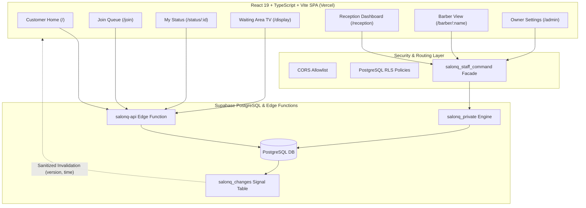
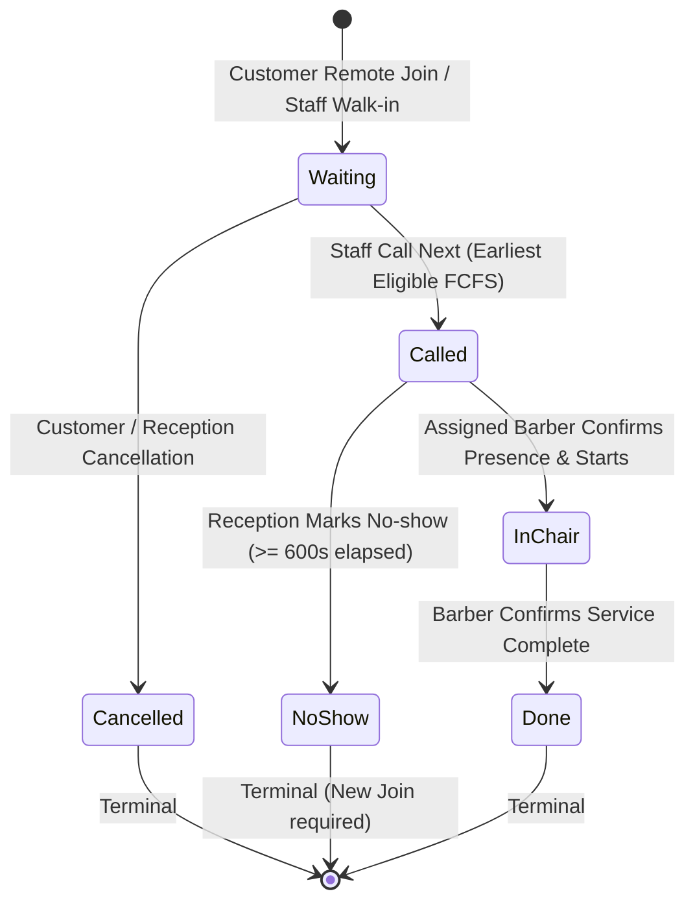

# SalonQ — Smart Salon Queue Management

**Live Demo:** [https://salon-queue-snowy.vercel.app/](https://salon-queue-snowy.vercel.app/)  
**Hosted on:** Vercel + Supabase  
**Tagline:** *Your Time. Your Turn.*  

> **Educational Project Notice:** SalonQ is an academic demonstration developed for a college Vibe Coding assignment. It uses fictional customer data and pre-provisioned demonstration accounts. Real customer personal or payment information is never requested.

---

## 1. Project Introduction & Overview

**SalonQ** is a modern, real-time salon queue management system designed to eliminate waiting room congestion and customer uncertainty. Built with React 19, TypeScript, Tailwind CSS, Vite, and Supabase PostgreSQL, SalonQ provides an end-to-end digital waiting experience connecting customers, salon receptionists, barbers, waiting room displays, and salon owners across seven synchronized screens.

### Problem Statement
Traditional salon queues are opaque and stressful. Customers arrive without knowing how long they will wait, waiting rooms become overcrowded, and walk-ins compete unpredictably with remote bookings. Salon staff face interruptions while trying to manage service times and queue order manually.

### Proposed Solution
SalonQ introduces a transparent, multi-interface digital queue:
- **Customers** join the queue remotely or as walk-ins, choose their preferred services and barbers, and track their live queue position on their own mobile devices via an opaque, private capability link.
- **Receptionists** manage the floor with an automated, serialized Call Next engine that respects customer barber preferences and Fair First-Come-First-Served (FCFS) rules.
- **Barbers** have a dedicated, focused chair workspace with persisted server timers and single-click service lifecycle transitions.
- **Waiting Area TV** provides a high-visibility, 1080p-optimized display with champagne-gold token callouts and Web Audio chime alerts, preserving total customer privacy.
- **Salon Owners** access real-time daily performance metrics (Asia/Kolkata timezone), opening hours management, service catalog editing, and barber duty controls.

---

## 2. Key Features

- **No Customer Accounts Needed**: Customers receive a unique token (e.g. `S-042`) and an opaque 64-character private capability key. No account registration or password required.
- **Privacy-First Public Display**: The TV display (`/display`) exposes tokens only. Zero customer names, phone numbers, or private tracking keys appear on public screens.
- **Serialized Eligible FCFS Engine**: Call Next atomically assigns the earliest waiting customer whose preference matches the calling barber or has selected "Any Barber".
- **Transactional State Transitions**: PostgreSQL stored procedures enforce strict unidirectional lifecycle states (`waiting` → `called` → `in_chair` → `done`, `cancelled`, `no_show`). Statuses never move backward.
- **Bilingual English & Gujarati Support**: Centralized i18n dictionaries provide instant one-click translation across all screens, with local WOFF2 font coverage (Noto Sans Gujarati) and zero layout clipping.
- **Sanitized Realtime Invalidation**: All screens subscribe exclusively to `salonq_changes`, triggering authorized snapshot refetches without streaming private queue tables across WebSockets.
- **Ten-Minute No-Show Guard**: A customer who is called cannot be marked as a no-show until exactly 10 minutes (600 seconds) of server-measured time have elapsed.

---

## 3. The Seven Application Screens

1. **Customer Home (`/`)**: Displays live salon status, operating hours, estimated wait times, and a private pass resume button.
2. **Customer Join Queue (`/join`)**: Mobile admission form with name, Indian phone number (+91 normalization), 1–3 service selections, and barber preference.
3. **Private My Status (`/status/:id` & `/status/resume`)**: Real-time position tracking, approximate wait, arrival alert at position 2, and confirmed cancellation.
4. **Reception Dashboard (`/reception`)**: Live floor overview, barber cards, waiting queue table, Call Next, Add Walk-in dialog, and No-show management.
5. **Barber Workspace (`/barber/:name`)**: Active chair timer from server timestamp, service overrun warning, Start service, and confirmed Done.
6. **Waiting Area TV Display (`/display` with `/tv` redirect)**: 1080p full-screen display, station tokens, Up Next 5 tokens, champagne-gold callout banner, and audio chime.
7. **Owner Settings (`/admin`)**: Daily IST performance metrics (served, average wait, no-shows), online queue toggle, opening hours editor, service catalog CRUD, and team duty.

---

## 4. Architecture Diagram



---

## 5. Technology Stack

- **Frontend**: React 19.3, TypeScript 5.8, React Router 8.5, Tailwind CSS 4.3, Lucide React icons.
- **Typography**: `@fontsource-variable/inter` (UI), `@fontsource-variable/playfair-display` (Headings), `@fontsource-variable/noto-sans-gujarati` (Gujarati). All locally bundled in WOFF2 format.
- **Backend**: Supabase PostgreSQL 15, Deno Edge Functions, Supabase Auth.
- **Realtime**: PostgreSQL Realtime broadcast via `salonq_changes` table invalidation.
- **Audio**: Zero-dependency Web Audio API harmonic tone synthesizer.
- **Testing**: Vitest, React Testing Library, jsdom, pg offline test runner, Deno type-checking, ESLint.
- **Hosting & CI/CD**: Vercel (Frontend SPA) + Supabase (Database, Auth & Edge Functions).

---

## 6. Queue Lifecycle Model



---

## 7. Setup & Local Development Instructions

### Prerequisites
- Node.js `24.x` or compatible LTS
- npm `10.x` or later
- (Optional) Deno for Edge Function testing

### 1. Clone the repository
```bash
git clone https://github.com/202612019/Salon-Queue.git
cd Salon-Queue/salon-queue-management
```

### 2. Install dependencies
```bash
npm install
```

### 3. Configure environment variables
Create `.env.local` inside `salon-queue-management/`:
```ini
VITE_SUPABASE_URL=https://your-project.supabase.co
VITE_SUPABASE_PUBLISHABLE_KEY=your-supabase-publishable-key
```

### 4. Start local development server
```bash
npm run dev
```
The application opens at `http://127.0.0.1:5173/` (or `http://127.0.0.1:5174/`).

---

## 8. Database Migration Instructions

Database migrations are located in `supabase/migrations/`:
- `20261124000100_core_schema.sql`: Core tables, enums, indexes, and RLS policies.
- `20261124000200_transactional_operations.sql`: Serialized queue operations (`admit`, `call_next`, `start`, `done`, `cancel`, `no_show`).
- `20261124000300_realtime_signal.sql`: Sanitized change signal table (`salonq_changes`).
- `20261124000400_staff_retry_authorization.sql`: Private schema security facade and retry authorization check.

Apply migrations using the Supabase CLI:
```bash
supabase db push
```

---

## 9. Verification & Testing Evidence

All automated test suites execute cleanly:
- **`npm test`**: **108 / 108 PASS** (Unit and integration tests across 8 test suites).
- **`npm run test:sql`**: **67 / 67 PASS** (Real PostgreSQL assertions verifying RLS, transactions, and edge cases).
- **`phase5-hosted.test.tsx`**: **10 / 10 PASS** (Live hosted checkpoints for TV, Owner, and security).
- **`phase4-hosted.test.tsx`**: **17 / 17 PASS** (Live hosted regression checkpoints for staff operations).
- **`npm run lint`**: **PASS** (0 errors, 0 warnings).
- **`npm run build`**: **PASS** (TypeScript and Vite production bundle with optimized code splitting).
- **`npm run env:check`**: **PASS** (Zero exposed secrets or untracked credentials).
- **`npm run check:edge`**: **PASS** (Deno compilation check).
- **`npm run backend:probe`**: **PASS** (Hosted Supabase connectivity probe).

---

## 10. Demonstration Accounts & Evaluator Instructions

Pre-provisioned accounts for academic evaluation:
- **Salon Owner**: `owner-demo@salonq.example` (Authorized for `/admin` and `/reception`)
- **Receptionist**: `reception-demo@salonq.example` (Authorized for `/reception`)
- **Barber Ravi**: `ravi-demo@salonq.example` (Authorized for `/barber/ravi`)
- **Barber Amit**: `amit-demo@salonq.example` (Authorized for `/barber/amit`)
- **Barber Imran**: `imran-demo@salonq.example` (Authorized for `/barber/imran`)

> *Security Notice:* Staff passwords are protected in the local DPAPI credential store (`.artifacts/demo-accounts.dpapi.json`) and are never published to public Git repositories. Credentials have been provided to the evaluation committee via the college's secure submission channel.

---

## 11. AI Coding Methodology & Attributions

This project was developed as a Vibe Coding assignment leveraging cutting-edge agentic AI:
- **Initial Planning & Customer Screens**: Developed with OpenAI Codex.
- **TV Display, Owner Settings, Security Hardening & Release**: Completed with **Google Antigravity**.
- **Continuous Verification**: Every architectural decision, SQL migration, and component addition was rigorously validated with automated test suites before committing.

---

## 12. Project Documentation Links

- [Brief & Requirements](salon-queue-management/docs/01-brief.md)
- [Screen Specifications](salon-queue-management/docs/02-screens.md)
- [Flows & Queue Rules](salon-queue-management/docs/03-flows-rules.md)
- [Final Phase 6 Verification Report](salon-queue-management/docs/final-verification.md)
- [Three-Minute Presentation Script](salon-queue-management/docs/demo-script.md)
- [Engineering Reflection Draft](salon-queue-management/docs/reflection-draft.md)
- [Development Prompts History](salon-queue-management/prompts.md)
