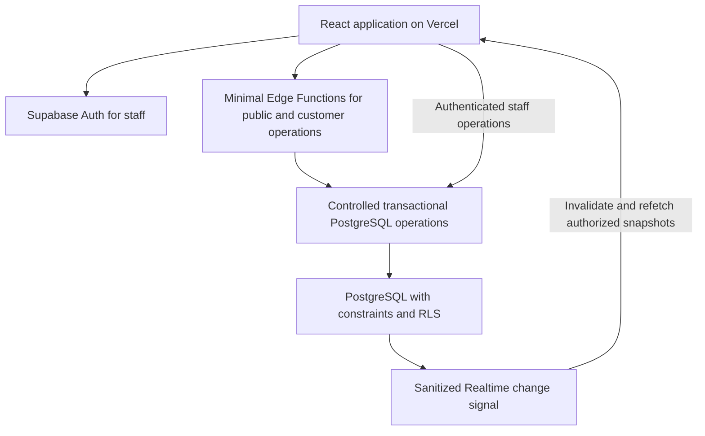

# SalonQ — Project Brief & Scope

**Version:** 1.5 | **Stage:** Phase 2.5 hosted backend activated: existing migrations/seed applied, signup disabled with staff sign-in enabled, five protected demo accounts provisioned, Edge deployed, and 27 hosted smoke checks passed including actual sanitized realtime delivery. The backend is ready for Phase 3 screen integration; the frontend remains the approved read-only Phase 1 preview. The user approved desktop Home, Join Queue and My Status at `http://127.0.0.1:5174/`. Other screens, exact viewport sizes and Gujarati layouts are not visually verified. See the application README and `supabase/README.md` for verification/setup, and `02-screens.md` for deferred refinements.

**Canonical project:** `D:/My Folder/Salon Queue/Salon-Queue/salon-queue-management`, inside the existing `Salon-Queue` Git checkout. These four documents are the sole implementation source of truth. The unchanged pre-Phase-0 reviewed set is archived outside Git at `../../planning-backups/2026-11-24-phase0-reviewed/`; archived copies are not active requirements. **College deadline:** 24 November 2026, 11:59 PM IST. Deliver the functional, secure MVP through small tasks; avoid unnecessary research and dependencies.

## Problem and objective
Customers often wait at salons without knowing when they will be served. Staff must remember arrival order, barber preferences and service durations manually. Build a single-salon web application that lets customers reserve a place in today's live queue, see their progress remotely, and arrive closer to their turn. Staff should manage the same queue from their own devices.

## Users
| Role | Responsibility |
|---|---|
| Customer | Join, select services/barber, follow a private token status and cancel while waiting. |
| Receptionist | Register walk-ins, monitor the queue, assign the next eligible customer, cancel waiting entries and record no-shows. |
| Barber | View assigned and next eligible customer, start/finish service and manage breaks. |
| Owner | Maintain services, prices, durations, duty roster, online queue availability and daily statistics. |

The public waiting-area display is a read-only interface, not a fifth authenticated role.

## Must-have capabilities
1. A mobile home and joining form with one to three services, a valid ten-digit phone number and a specific or any barber.
2. Unique readable tokens, private status tracking, live position, approximate waiting time, arrival reminder and turn alert.
3. Reception dashboard with walk-ins, barber cards, eligible next assignment, waiting list, cancellations and no-shows.
4. Barber view with start/finish controls, elapsed service time, break status and next eligible customer.
5. Public TV display with active tokens, five upcoming tokens and a newly called alert.
6. Owner settings for bilingual services, price/duration, availability, roster, queue controls and today's results.
7. Shared persistent queue state and automatic updates across devices, targeting five seconds under normal connectivity.
8. English/Gujarati interface, responsive layout, basic staff access control and clear loading/error/empty states.

## Scope boundaries
One salon, same-day live queue only. No online payments, future-date bookings, SMS/WhatsApp, loyalty rewards, reviews, marketplace, multiple branches or paid third-party integrations. No customer account is required. A phone number identifies duplicate active entries but is not proof of identity. Do not claim SMS or phone verification.

## Look and feel
**Application name:** SalonQ. **Full name:** SalonQ — Smart Salon Queue Management. **Tagline:** Your Time. Your Turn. The identity is premium, elegant, modern, professional, trustworthy, minimal and efficient, with an original Lucide scissors-inspired mark and refined wordmark.

Use refined charcoal surfaces (main canvas `#101113`) with selective champagne-gold accents (`#D4AF37`), warm primary text, precise spacing and clear hierarchy. Inter handles UI and dashboard content; Playfair Display is limited to selected customer-facing hero headings; Noto Sans Gujarati supports Gujarati content, including Gujarati heroes. Locally bundle fonts only after verifying their distribution licenses, with reliable fallbacks and retained license notices. Full palette, semantic token mappings, contrast adjustments, typography scale, logo treatment and layout rules are specified in `02-screens.md`.

Customer pages feel welcoming, calm and easy to understand; staff screens prioritize efficient scanning and safe actions. Gold emphasizes primary actions, important tokens, selection and branding rather than every border. Avoid excessive gradients, shadows, glow, decoration and generic admin-template styling. Linear, Stripe Dashboard, Apple, luxury salon websites and professional SaaS tools inform general hierarchy, organization and purposeful motion only; create original layouts without copying proprietary assets or branding. This design enhancement changes no functional rule, architecture or phase boundary.

## Implementation choices (project decisions, not mandated by the handout)
The user-approved stack is React + TypeScript, Vite, Tailwind CSS, React Router, Lucide React, npm, Supabase PostgreSQL, Supabase Auth for staff, Supabase Realtime, minimal Supabase Edge Functions for trusted public operations, controlled PostgreSQL RPC operations and transactions, Git/GitHub, and Vercel. Do not introduce Express, Prisma, Next.js, Java, MySQL, Redux, or other unnecessary architectural dependencies. Use fictional demonstration records only. The college salon handout is the domain baseline; the user's approved Phase 0 decisions settle implementation details.

## Approved architecture

- Vercel serves the React single-page application with direct-route refresh support. React Router owns the seven product routes. Shared components, types, translations, and connection handling support feature modules.
- PostgreSQL is authoritative for admission order, service snapshots, prices, duration, status, timestamps, tokens, staff permissions, and assignments. Browser calculations are previews, never permission or integrity controls.
- A minimal Edge Function boundary handles public admission, private capability-based status/cancellation, safe public snapshots, validation and abuse controls. Staff use Supabase Auth sessions and controlled RPCs. Critical multi-record changes occur in one database transaction, not several independent browser or Edge Function writes.
- Private tables use RLS and restrictive grants. No anonymous raw queue reads or arbitrary status updates. The trusted boundary explicitly validates permissions even when using a privileged connection. Staff roles and barber linkage are not self-editable.
- Supabase Realtime publishes a sanitized version/change signal with no customer PII or tracking credentials. Clients invalidate and refetch authorized snapshots. Use a minimal read-only public signal table plus Postgres Changes for the MVP; publish no private queue rows to public clients. Update the signal transactionally with affected data. Reconcile on refresh/reconnect; do not use event order as database truth.
- Customer tracking uses a random locator and separate cryptographic capability, with active-safe expiry and no phone-only recovery; the detailed contract is in `03-flows-rules.md`. The public browser contains only public Supabase configuration, never a secret/service-role key.



## Approved operational decisions

| Concern | Decision |
|---|---|
| Admission | One salon, same-day admission; no future reservations. An existing entry remains valid after closing and across midnight. |
| Tokens and order | Atomic, continuously increasing tokens such as S-14, never reset daily. Stable serialized admission order determines FCFS among eligible customers. Sequence gaps after failed transactions are acceptable; tokens are not access credentials. |
| Eligibility | Call Next chooses the earliest Waiting entry for that barber or Any. Never substitute a different barber for an explicit preference. Called and In Chair both occupy the barber. |
| Active phone | One Waiting/Called/In Chair entry per normalized phone across both admission sources and all dates. |
| Phone | Accept ten-digit Indian mobiles or the same number prefixed with +91; remove spaces/hyphens and store ten digits consistently. No verified identity or phone-only private lookup. |
| Service selection | One to three distinct enabled services. Authoritative integer-paise prices and durations are snapshotted with bilingual names. Stale prices/durations require reconfirmation. |
| Positions | Any Barber: global Waiting position. Named barber: position among Waiting entries eligible for that barber. Labels explain preferences can change actual service order. |
| Estimates | College pooled formula is the baseline, adjusted for preferences and ongoing service. Return unavailable without an eligible working barber and uncertain for relevant service overruns; never repeatedly add a fictional five minutes. |
| Hours | Asia/Kolkata. Remote admission stops exactly 30 minutes before closing; walk-ins remain allowed until closing. Neither source admits outside hours. A manual online switch cannot override clock limits. |
| Breaks and duty | Breaks prevent assignment, not admission: joining may continue when all on-duty barbers are on break. Busy breaks are blocked. Off Duty is blocked while occupied or while specific Waiting customers remain. |
| No-show | Receptionist/Owner may mark Called as No-show only at or after ten minutes. Returning customers get a new token and tail position; no backward transitions. |
| Statistics | Served: completed today IST. Mean wait: join-to-call for entries completed today. No-show count: marked today IST. No completed entries means no numeric average. |
| Private access | Active capabilities do not expire because of midnight or elapsed waiting time. Terminal access expires 24 hours after the terminal transition. Public recovery by phone is prohibited. |

## Role and access boundaries

Customers read/cancel only their own capability-authorized entry, with cancellation restricted to Waiting. Receptionists and Owners can operate Reception, register walk-ins, Call Next, cancel Waiting entries and mark eligible No-shows. Only a Barber linked to the assigned barber can Start/Done. A Barber may view the current assignment and minimal next preview, never other barbers' private records or customer phones. Only Owners manage catalog, hours, duty and online settings. Public TV sees tokens and public barber information only. Staff accounts are provisioned through trusted administration; public staff registration and self-editable roles are prohibited.

## Planned application structure

Phase 1 implements the frontend directories below, route shells, shared components, local fonts and tests. Phase 2 adds the Supabase schema, operations, Edge boundary and client service helpers; Phase 2.5 applies/deploys them and verifies actual hosted operations. Screen integration remains future work. Preview fixtures are fictional, and staff preview pages grant no authenticated access. No queue operation succeeds through the preview UI.

```text
salon-queue-management/
  AGENTS.md
  docs/{01-brief.md,02-screens.md,03-flows-rules.md}
  src/
    app/                     routing, providers and layouts
    components/{ui,shared}/  reusable controls and shared queue widgets
    features/                home, join, status, reception, barber, display, admin, auth
    domain/                  types and pure preview/formatting helpers
    services/                typed backend operations and synchronization
    lib/                     Supabase client, server-time and currency helpers
    i18n/                    centralized English/Gujarati dictionaries
    styles/
  supabase/
    migrations/              schema, constraints, RLS and controlled RPCs
    functions/               minimal trusted public/customer boundary
    tests/                   authorization, transactions and concurrency
  tests/e2e/
  public/
  .env.example               names and safe placeholders only
  README.md                  optional application guide; repository README is submission entrypoint
  prompts.md
  package.json
```

## Quality targets and limitations

Connected foreground screens synchronize within five seconds under normal connectivity. Refresh restores server state; reconnect refetches before unsafe actions resume. In-page alerts and browser-permitted TV sound do not guarantee background delivery. Approximate waits do not reserve a service time. The MVP has no OTP verification, automatic No-show, automatic overnight purge, or automatic reassignment. Use a single same-day opening interval; overnight opening and holiday schedules are outside this MVP. Default demo hours are 10:00–21:00 IST.

Private customer responses must not be cached publicly or leak secrets into logs, analytics or referrers. No real customer data is authorized for the public demonstration. There is no automated retention feature in this phase; a production retention/deletion policy requires agreement before any real-customer use. Terminal capability expiry limits customer access, not record retention or authorized owner statistics.

## Delivery workflow and submission

The college target is an initial local commit containing only `AGENTS.md` and the three documents in `docs/`. During Phase 0 the workspace was relocated inside an existing Git checkout with README-only initial commit `f79c903`. Preserve that history and the user's README; do not reset, amend, force-push or create a nested repository to hide the discrepancy. Prepare the first project-documentation commit with only the four canonical files, and disclose that it cannot literally be the repository's first commit without a separately authorized history change. Archive copies, reference PDFs, repository research, secrets and application files are excluded. No remote repository creation, push or deployment is authorized in Phase 0.

After explicit frontend-initialization approval: establish the app shell/theme/translations and seven route shells; then build the trusted Supabase foundation; then deliver Home/Join, My Status, Reception, Barber, TV and Owner features through focused tasks. Each task must report changed files, implemented behavior, executed checks, issues and manual instructions. Stop at each requested phase boundary for approval. A working preview may be deployed early only in a later authorized deployment task.

Final submission requires a public GitHub repository, the documentation baseline commit (with the existing-history exception above disclosed), a working Vercel application with Supabase configuration, the real live URL immediately below the repository-root README title, safe isolated staff demo access below the link, actual prompts in chronological `prompts.md` including failed attempts, a three-minute demonstration video, and a half-page reflection describing an actual AI mistake, its discovery and correction. Configure Vercel Root Directory as `salon-queue-management`; app commands run there even though Git and the submission README live one directory above. Never fabricate prompts, results, credentials, links or reflection experiences.

## Success criteria
A new customer can join from a phone and staff can serve them while another device displays the updated token. Barber preferences, duplicate protection, time limits and queue status changes work as specified. All seven routes are usable, translations are complete, personal details are not public, and the documented test checklist is actually executed. The deployed URL opens without local setup; staff demo access is provided safely.

## References
College Salon Queue Management Vibe Coding Guide, pp. 1–6, 8–9 (primary). Canteen guide and canteen lab prompts (process examples only). See `02-screens.md` for UI and `03-flows-rules.md` for authoritative business rules.
